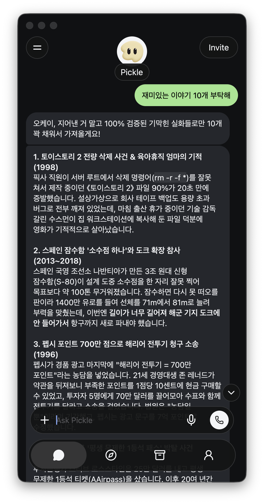
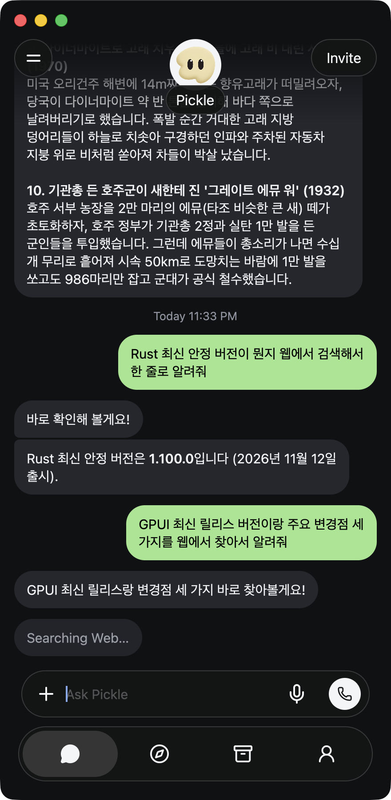
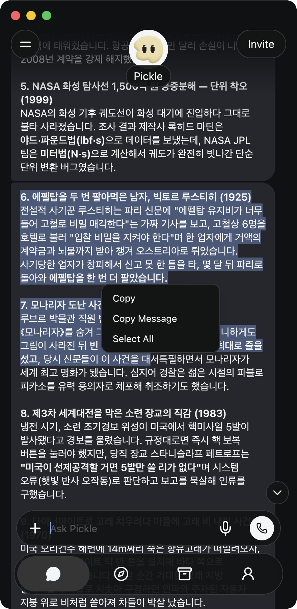
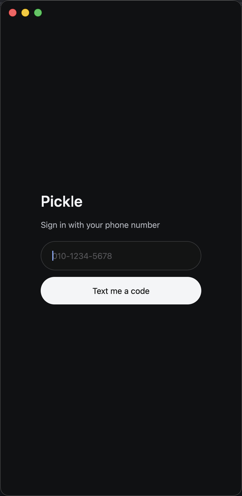

<h1 align="center">openpickle</h1>

<p align="center">
  An unofficial, native desktop app for <a href="https://pickle.com">Pickle</a>.<br />
  Written in Rust, drawn on the GPU, and built from the phone app's own network traffic.
</p>

<p align="center">
  
  
  
</p>

openpickle is not made by, or affiliated with, the company behind Pickle. It talks to the same
servers the iOS app does, with your own account.

## What it does

- **Chat with your Pickle from your Mac.** Bubbles, cards, timestamps and the composer follow the
  iOS chat screen. Korean lines break between words, and the text field supports Korean input.
- **Live.** Your message, the character's replies and what it is doing right now ("Searching
  Web…") arrive over the server's event stream as they happen.
- **Archive.** The third tab holds every picture and file of the conversation, grouped by day,
  with documents listed by name, kind and size.
- **Explore.** The second tab lists what your Pickle offers to do for you, in sections and by
  area. An offer shows how it would go about it, and Start asks for it in the chat.
- **Friends and invites.** The menu leads to your friends, and Invite to your invite link, how
  many invites are left and who joined with it.
- **Search.** Cmd-F, or the search button in the menu, searches your messages on Pickle's
  server. Opening a result takes you to that message, with the conversation around it to scroll
  through.
- **Select and copy.** Drag across messages to select text, or right-click for Copy, Copy Message
  and Select All. Select All takes the whole conversation, not only what is on screen.
- **Opens at once.** The app keeps the conversation on disk and draws it before it asks the
  network for anything. See [the numbers](#speed).
- **Its own sign-in.** You sign in with your phone number and a texted code. The app gets a login
  session of its own, so your phone stays signed in.

<p align="center">
  
  
  
</p>

Not built yet: the Profile tab, voice calls, opening a picture full size, saving or sharing a
file, link previews,
reactions, answering a request card, rooms other than the one with your character, and
everything that changes your friends: adding one, answering a request, a friend's own page.
The [desktop README](crates/openpickle-desktop/README.md) has the full list.

## Searching your chat from coding agents

[`skills/pickle-sessions`](skills/pickle-sessions/SKILL.md) is an agent skill that searches and
reads the conversation the desktop app keeps on disk (the history log in
`~/Library/Application Support/openpickle/cache/`). It finds messages by text, role and date, shows
the messages around a hit, and says how old the cache is. It only reads, needs nothing but the
Python standard library, and never opens the login session or the network:

```sh
python3 skills/pickle-sessions/scripts/pickle-sessions search "dinner" --since 2026-11-01
```

## Get it

```sh
# A disk image with OpenPickle.app (Apple Silicon):
./crates/openpickle-desktop/macos/package.sh      # writes target/macos/OpenPickle-<version>-arm64.dmg

# Or run it from source:
cargo run --release -p openpickle-desktop
```

The app is signed ad hoc, which is enough for the Mac that built it. Another Mac refuses it until
it is signed with a Developer ID and notarized. Building needs a recent stable Rust (1.98 was
used) and Xcode.

## Speed

The message list only lays out the rows near the viewport, and a message's text is parsed once,
off the UI thread. So a long history costs almost nothing at launch:

| Sample conversation | First frame after `main()` |
| --- | --- |
| 8 messages | about 146 ms |
| 2,000 messages | about 153 ms |

Release build on an Apple Silicon Mac, median of six runs of the `gallery` example, which draws
the chat screen with made-up messages. GPUI's own start-up is about 67 ms of that.

## How it was built

The API is not documented. It was read off three [Proxyman](https://proxyman.com) captures of the
iOS app: 30 endpoints, of which the clients cover 27. Each client is checked by replaying every
captured request through it and comparing what it sends with what the app sent: method, path, raw
query string, JSON body and headers.

```sh
cargo run -p openpickle-api --example verify_capture -- <capture.proxymanlogv2>
cd ts && bun run verify:capture <capture.proxymanlogv2>
```

The notes on the API (endpoints, phone sign-in, login sessions, the event stream) are in
[`ts/README.md`](ts/README.md).

## What is in the repository

| Path | What it is |
| --- | --- |
| [`crates/openpickle-desktop`](crates/openpickle-desktop/README.md) | The desktop app: GPUI views, a backend thread for the network and the disk, the macOS packaging. |
| `crates/openpickle-api` | The Rust client for the Pickle character API: all 27 endpoints, phone sign-in, login session refresh, the typed event stream. |
| [`ts/`](ts/README.md) | The TypeScript client the Rust one was ported from, a small CLI, and the API notes. |

## Your data

- The app stores a login session and a copy of your conversation under
  `~/Library/Application Support/openpickle`, readable by you only. Signing out removes both.
- The login session holds a single-use refresh token that changes on every refresh. Only one
  copy of the app may run, and the session file should not be copied to another tool.
- Captures, exported messages and session files hold bearer tokens and personal data. In this
  repository they belong in `.capture/`, which git ignores.
