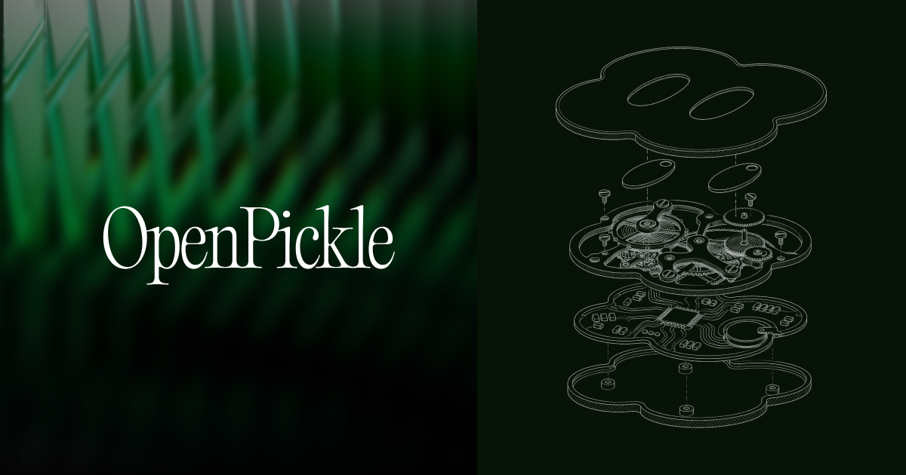
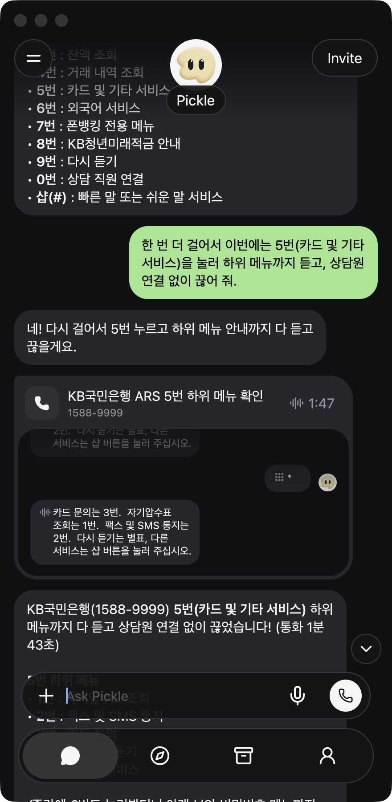
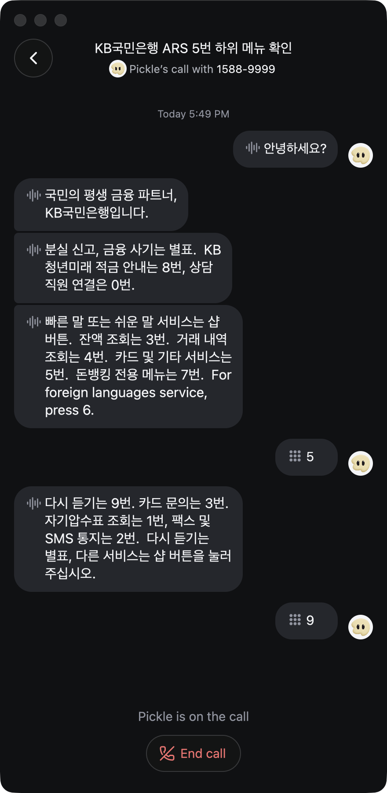
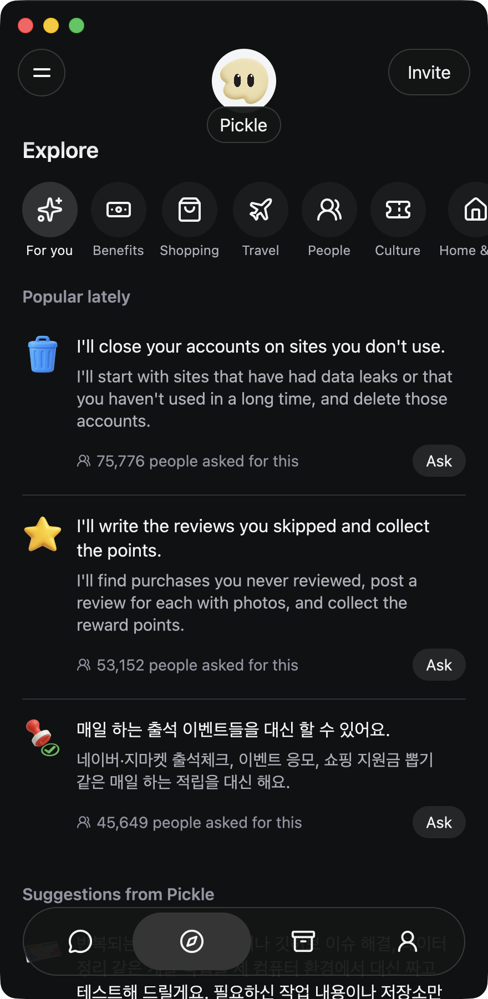
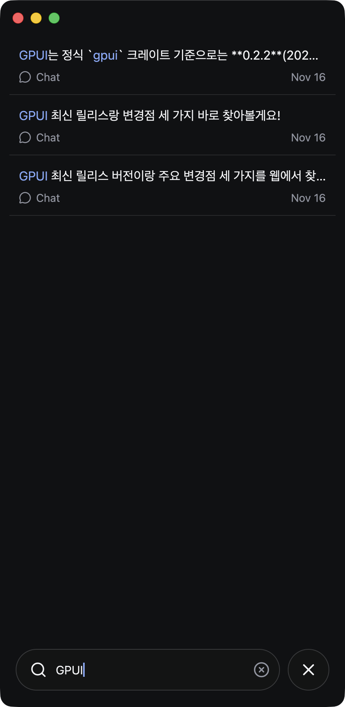

<h1 align="center">openpickle</h1>

<p align="center">
  An unofficial, native desktop app for <a href="https://pickle.com">Pickle</a>.<br />
  Written in Rust, drawn on the GPU, and built from the phone app's own network traffic.
</p>

<p align="center">
  
  
  
</p>

openpickle is not made by, or affiliated with, the company behind Pickle. It talks to the same
servers the iOS app does, with your own account.

## What it does

- **Chat with your Pickle from your desktop.** Bubbles, cards, timestamps and the composer follow
  the iOS chat screen. Korean lines break between words, and the text field supports Korean input.
- **Live.** Your message, the character's replies and what it is doing right now ("Searching
  Web…") arrive over the server's event stream as they happen.
- **Archive.** The third tab collects pictures and files as conversation history loads. It
  groups them by day and lists documents by name, kind and size.
- **Explore.** The second tab lists what your Pickle offers to do for you, in sections and by
  area. An offer shows how it would go about it, and Start asks for it in the chat.
- **Phone calls.** A call Pickle placed shows in the chat as a card with the end of its
  transcript. Open it to read the whole call as it goes, and request an end only after
  confirmation. Opening a call or the call list does not dial a number.
- **Tasks.** A task Pickle takes on shows in the chat as a card with what it is doing now and
  for how long, and the chat's header names it while it runs. Open the card to read the
  task's plan and the log of its steps. The app only reads a task: it cannot cancel one.
- **My Pickle.** The fourth tab shows account, usage, reset-ticket holdings and connected-service
  information. The usage card opens the detailed, read-only Usage screen.
- **Friends and invites.** The menu leads to your friends, and Invite to your invite link, how
  many invites are left and who joined with it.
- **Search.** Cmd-F (Ctrl-F on Windows), or the search button in the menu, searches your
  messages on Pickle's server. Select a result to jump to it; if it is not cached, the app
  first loads the nearby messages.
- **Select and copy.** Drag across messages to select text, or right-click for Copy, Copy Message
  and Select All. Select All includes loaded messages beyond what is on screen.
- **Cached chat.** For a returning session, the app can show cached messages before the
  network refresh. See [what the gallery benchmark measures](#speed).
- **Its own sign-in.** You sign in with your phone number and a texted code. The app gets a login
  session of its own, so your phone stays signed in.

<p align="center">
  
  
</p>

<p align="center">
  
  
  
</p>

Right-click a confirmed text bubble and choose **Reply** to attach a quote to your next
message. Clear it with the × in the composer or Escape. Mixed-content messages do not offer
Reply because their part numbering is not established. Outbound reply compatibility is
inferred from saved history and has not been verified against the live service. The app also displays reactions in
received messages. It does not send reactions or request-card answers, upload or share files, generate website
previews, or manage friends, tickets, or account settings. Direct microphone chat is not
implemented. See the [desktop README](crates/openpickle-desktop/README.md) for details.
The published v1.0.0 downloads predate the newer source changes.

## Searching your chat from coding agents

[`skills/pickle-sessions`](skills/pickle-sessions/SKILL.md) is an agent skill that searches and
reads the primary conversation the desktop app keeps on disk (on macOS, under
`~/Library/Application Support/openpickle/cache/`). It finds messages by text, role and date, shows
the messages around a hit, and says how old the cache is. It only reads, needs nothing but the
Python standard library, and never opens the login session or the network:

```sh
python3 skills/pickle-sessions/scripts/pickle-sessions search "dinner" --since 2026-11-01
```

## Get it

Download the packaged app from [GitHub Releases](https://github.com/junhoyeo/openpickle/releases).
[v1.0.0](https://github.com/junhoyeo/openpickle/releases/tag/v1.0.0) includes:

- `OpenPickle-1.0.0-arm64.dmg` for Apple Silicon Macs;
- `OpenPickle-1.0.0-x86_64.dmg` for Intel Macs;
- `OpenPickle-1.0.0-windows-x86_64.zip` for Windows 10 and 11 on x86-64 PCs.

The Windows release check verifies that the unpacked executable opens a window. It does not
verify sign-in, Korean input or other in-app workflows. The Intel build was launched under
Rosetta, not tested on Intel hardware. There are no published Windows ARM64 or Linux packages.

On macOS, drag OpenPickle to Applications. The app is ad hoc signed and is not notarized. On its
first launch, Control-click OpenPickle in Finder, choose **Open**, then confirm **Open**. If macOS
still blocks it, use **System Settings > Privacy & Security > Open Anyway**.

On Windows, extract the zip and run `OpenPickle.exe`. The app is not code-signed. If SmartScreen
blocks it, choose **More info > Run anyway** after verifying that you trust the download.

To build or run it from source:

```sh
# Build a DMG for this Mac, or pass aarch64-apple-darwin / x86_64-apple-darwin.
./crates/openpickle-desktop/macos/package.sh

cargo run --release -p openpickle-desktop
```

Building needs a recent stable Rust (1.98 was used). macOS packaging also needs Xcode.

## Speed

The message list only lays out rows near the viewport. The `gallery` example measures how long
it takes to open a chat window and draw its first frame from prebuilt sample messages:

| Sample conversation | First frame after the gallery timer starts |
| --- | --- |
| 8 messages | about 146 ms |
| 2,000 messages | about 153 ms |

These are historical medians of six release-build runs on an Apple Silicon Mac. The timer
starts after creating the sample messages and, for the larger sample, cloning them. It does
not measure production startup, including reading and converting the on-disk chat history, or
waiting for the network. These numbers do not establish startup times on other platforms or
with larger histories.

## How it was built

The API is not documented. It was read off seven [Proxyman](https://proxyman.com) captures of the
iOS app. Each client is checked by replaying the captured requests it covers and comparing
what it sends with what the app sent: method, path, raw query string, JSON body and headers.
The verifier reports uncovered routes separately instead of treating them as passing.

```sh
cargo run -p openpickle-api --example verify_capture -- <capture.proxymanlogv2>
cd ts && bun run verify:capture <capture.proxymanlogv2>
```

The notes on the API (endpoints, phone sign-in, login sessions, the event stream) are in
[`ts/README.md`](ts/README.md).

## What is in the repository

| Path | What it is |
| --- | --- |
| [`crates/openpickle-desktop`](crates/openpickle-desktop/README.md) | The desktop app: GPUI views, a backend thread for the network and the disk, the macOS packaging. |
| `crates/openpickle-api` | The Rust client for the captured Pickle API: phone sign-in, login session refresh, typed event stream, message search, attachments and phone-call transcripts/actions. |
| [`ts/`](ts/README.md) | The TypeScript client the Rust one was ported from, a small CLI, and the API notes. |

## Chat links and attachment previews

- Room cards and `pickle://chat?room_id=…` links open a conversation listed by the
  signed-in account's `sync()` response. The menu's **Other chats** lists those rooms;
  **Chat** returns to your own character. Observer rooms have no send composer.
- Room history, pending messages, drafts, read cursors and live updates stay scoped to
  their room. Unscoped character events are not inserted into a peer conversation.
- Generated file links are resolved through the message's attachment map. Clicking a
  file card or its linked name opens a **thumbnail preview**. For a PDF this is its
  **first page**, not the original document. Loading failures show a retry action.
- **Download** saves the original to Downloads even if it has no thumbnail. The app chooses a
  free filename (such as `report (1).pdf`) rather than overwriting a file. A transfer can be
  canceled from its file panel. Open a downloaded image at full size, or use **Show in Finder**
  or **Show in folder** to find the saved file.

## Your data

- The app stores a login session and a copy of your conversation under
  `~/Library/Application Support/openpickle` on macOS, readable by you only, or
  `%APPDATA%\openpickle` on Windows, inside your user profile. In current source, choose
  **My Pickle → Sign out** to remove this desktop login and its local chat cache. This does not
  sign your phone out. Files you saved to Downloads are separate and are not removed.
- The login session holds a single-use refresh token that changes on every refresh. Only one
  copy of the app can use that data directory at a time. Do not copy the session file to
  another tool.
- Captures, exported messages and session files hold bearer tokens and personal data. In this
  repository they belong in `.capture/`, which git ignores.

## License

OpenPickle is released under the [MIT License](LICENSE). The icons are from
[Lucide](https://lucide.dev) under the ISC License; its notice is in
[`crates/openpickle-desktop/assets/icons/LICENSE`](crates/openpickle-desktop/assets/icons/LICENSE).

OpenPickle is an unofficial client. Pickle does not make, endorse or support it.
